<div align="center">

# Apple Account regions, for beginners

[中文](./README.md) · **English** · [日本語](./README.ja.md) · [한국어](./README.ko.md) · [Español](./README.es.md) · [Português](./README.pt.md) · [Français](./README.fr.md) · [Deutsch](./README.de.md) · [Русский](./README.ru.md) · [العربية](./README.ar.md)

### Keep your account, switch the store

For people in mainland China who want a US or Turkey Apple Account (Apple ID).<br>Three short lessons explain what an account's region decides, why iCloud and the App Store are two separate sign-ins, and why a second account is simpler than moving your main one.

**[Start with lesson 1 →](https://region.xiaoxiaodong.ai/en/start/1-region/)**　·　**[Already have one? The full guide →](https://region.xiaoxiaodong.ai/en/guide/0-why/)**

<sub>Unofficial · free · open source · 10 languages</sub>

</div>

<p align="center">
  
</p>

## The app a friend mentioned isn't there

A friend tells you about a great app. You search the App Store and get nothing. Tutorials online say a US account fixes that; others say subscriptions are cheaper in Turkey. You start tapping, your phone shows Sign Out, and your stomach drops: will the photos in iCloud go with it?

This site walks through those questions one at a time, and every sentence is checked against Apple's own support articles and terms.

## What an account's region decides

Every Apple Account belongs to one country or region. It decides which apps the App Store has, what currency prices are in and which payment methods you can use, and even Apple's own services differ by region. As of 2026-11-19, for example, Apple's per-region list shows Apple One and Apple Books in the United States, public-domain books only on Apple Books in Turkey, and no Apple Arcade or Apple TV in the China mainland list ([Availability of Apple Media Services](https://support.apple.com/en-us/118205)). Which regions an app is released in is the developer's choice ([App Store Connect Help](https://developer.apple.com/help/app-store-connect/manage-your-apps-availability/manage-availability-for-your-app-on-the-app-store)).

One more thing up front. Apple's Media Services Terms say the services are for use in your country or territory of residence, and that creating an account for a country or region specifies it as your Home Country ([US terms](https://www.apple.com/legal/internet-services/itunes/us/terms.html); the China mainland and Turkey terms say the same). So this site doesn't hand out addresses or show you how to make one up. If you live in the US or Turkey, use your real address. If you don't, lesson 1 lays out what the terms say, what they let Apple do and what Apple hasn't said publicly, and leaves the decision to you.

## Three lessons, one thing at a time

<p align="center">
  
</p>

1. **[What an account's region decides](https://region.xiaoxiaodong.ai/en/start/1-region/)**: the store's catalog, its currency and how you pay, and how Apple's terms tie the region to where you live.
2. **[iCloud and the App Store are two separate sign-ins](https://region.xiaoxiaodong.ai/en/start/2-two-sign-ins/)**: iCloud stays on your own account; the second account goes only under Media & Purchases. An account someone gives you never goes into iCloud.
3. **[Make a second account; leave your main one alone](https://region.xiaoxiaodong.ai/en/start/3-new-account/)**: moving your main account means clearing a list of things first, and a China mainland account's iCloud content also moves out of GCBD.

## Before a region change, Apple asks you to clear these

<p align="center">
  
</p>

The list comes from Apple's [Change your Apple Account country or region](https://support.apple.com/en-us/118283). The China mainland item comes from [Learn more about iCloud in China mainland](https://support.apple.com/en-us/111754) and the iCloud (operated by GCBD) terms.

## Already have a second account?

- **[The full guide](https://region.xiaoxiaodong.ai/en/guide/0-why/)**: seven steps, from knowing what you want it for, getting an email address and phone number ready, signing up and paying, to switching the App Store, subscription price rises and who to ask when an account is locked.
- **[How-to](https://region.xiaoxiaodong.ai/en/howto/)**: 12 specific jobs: creating a US or Turkey account, changing region, switching App Store accounts on your iPhone, buying and redeeming gift cards, price rises, "Your account cannot be created at this time", refused purchases, locked accounts, and tutorials you shouldn't follow.
- **[Wiki](https://region.xiaoxiaodong.ai/en/wiki/)** and **[FAQ](https://region.xiaoxiaodong.ai/en/faq/)**: terms like Media & Purchases, GCBD, gift cards and Activation Lock, and the questions people ask before signing up.

## Where this comes from

Every rule, step, button name and price is checked against Apple's support articles, the Apple Media Services Terms, the gift card terms and Apple's developer documentation, with a link on the page; prices carry the date they were checked. Where Apple doesn't say, for example whether a trusted phone number can be from another country, the page says Apple doesn't say. Experiences shared on X are quoted only as what someone tried, with a link.

This site won't teach these, even when other tutorials do:

- Specific addresses, address generators, "tax-free states"
- VPN, proxy or node setup
- Bought, borrowed or shared accounts, or getting around Activation Lock
- Discounted gift cards, top-up services, virtual cards and the like
- "Turkey is half price" comparisons, splitting or reselling subscriptions
- Referral codes, invite links or affiliate links, the author's own included

## Unofficial

Apple Account regions, for beginners is an independent guide and has not been authorized, sponsored, or otherwise approved by Apple Inc. It doesn't speak for Apple. Apple, App Store and iCloud are trademarks of Apple Inc. Account, payment and region rules change; [Apple Support](https://support.apple.com/en-us/apple-account) and Apple's terms are the reference. The site explains what the terms say; it isn't legal advice.

## Run it locally

```bash
npm install
npm run dev        # http://localhost:4460
npm run build      # output in dist/
npm run check      # after a build: Chinese/English parity and site checks
```

Stop the dev server when you're done and check the port is free with `lsof -i :4460`. The three animated images in the README are generated by scripts, which read lesson titles and times from `src/data/nav.js`:

```bash
python3 tools/build_hero.py          # assets/hero.svg, assets/en/hero.svg
python3 tools/build_readme_svgs.py   # move.svg and lessons.svg in assets/readme/ and assets/en/readme/
python3 tools/build_og.py            # share images public/og.png, public/og-en.png
```

Writing rules, sources and check scripts are in [docs/MAINTAINING.md](docs/MAINTAINING.md). The site shell comes from the [getting-paid-from-abroad guide](https://github.com/nevertoday/xxd-payout), with the Xiaoxiaodong UI Kit.

## License

The code and text are MIT licensed; see [LICENSE](LICENSE). `public/xxd/` is a build of the Xiaoxiaodong UI Kit and isn't covered by the MIT license; see `public/xxd/LICENSE`.
