<div align="center">

# Apple Account の国と地域 入門

[中文](./README.md) · [English](./README.en.md) · **日本語** · [한국어](./README.ko.md) · [Español](./README.es.md) · [Português](./README.pt.md) · [Français](./README.fr.md) · [Deutsch](./README.de.md) · [Русский](./README.ru.md) · [العربية](./README.ar.md)

### アカウントはそのまま、お店だけ切り替える

中国本土に住んでいて、米国やトルコの Apple Account（Apple ID）がほしい人のためのガイドです。<br>三つの短いレッスンで、アカウントの地域で何が決まるのか、iCloud と App Store がなぜ別々のサインインなのか、そしてメインのアカウントを移すより、もうひとつ作るほうがなぜ簡単なのかを説明します。

**[レッスン 1 から始める →](https://appleid.xiaoxiaodong.ai/ja/start/1-region/)**　·　**[もう持っている人は完全ガイドへ（英語）→](https://appleid.xiaoxiaodong.ai/en/guide/0-why/)**

<sub>非公式 · 無料 · オープンソース · 10 言語</sub>

</div>

<p align="center">
  
</p>

## 友だちが話していたアプリが、ない

友だちから、いいアプリがあると聞きました。App Store で探しても、何も出てきません。ネットの解説には、米国のアカウントにすれば解決すると書いてあるし、トルコならサブスクリプションが安いと言う人もいます。あれこれタップしているうちに、スマホに「サインアウト」が出てきて、ひやっとします。iCloud の写真まで一緒に消えてしまわないだろうか。

このサイトは、そういう疑問をひとつずつ説明していきます。どの文も、Apple 自身のサポート記事と規約と照らし合わせてあります。

## アカウントの地域で決まること

Apple Account はどれも、ひとつの国や地域に属しています。地域によって、App Store にどんなアプリがあるか、値段がどの通貨で表示されるか、どの支払い方法が使えるかが決まり、Apple 自身のサービスまで地域ごとに違います。たとえば 2026 年 11 月 19 日時点で、Apple の地域別の一覧では、米国には Apple One と Apple Books があり、トルコの Apple Books はパブリックドメインのブックだけで、中国本土の一覧には Apple Arcade も Apple TV もありません（[Appleメディアサービスの提供状況](https://support.apple.com/ja-jp/118205)）。アプリをどの地域で公開するかは、デベロッパが決めます（[App Store Connect ヘルプ](https://developer.apple.com/help/app-store-connect/manage-your-apps-availability/manage-availability-for-your-app-on-the-app-store)）。

もうひとつ、最初に伝えておきたいことがあります。Apple メディアサービス利用規約には、サービスはあなたが居住する国や地域で使うためのもので、ある国や地域向けにアカウントを作成すると、そこを自分の Home Country（居住国）として指定したことになる、と書かれています（[米国の規約](https://www.apple.com/legal/internet-services/itunes/us/terms.html)。中国本土とトルコの規約も同じです）。だからこのサイトは、住所を教えることも、住所をでっち上げる方法を教えることもしません。米国やトルコに住んでいるなら、本当の住所を使ってください。そうでないなら、レッスン 1 で、規約に何が書いてあるか、規約が Apple に何を認めているか、Apple が何を公表していないかを並べて、どうするかはあなたに任せます。

## 三つのレッスンで、ひとつずつ

<p align="center">
  
</p>

1. **[アカウントの地域で決まること](https://appleid.xiaoxiaodong.ai/ja/start/1-region/)**：お店の品ぞろえ、通貨、支払い方法。そして Apple の規約が、地域と住んでいる場所をどう結びつけているか。
2. **[iCloud と App Store は別々のサインイン](https://appleid.xiaoxiaodong.ai/ja/start/2-two-sign-ins/)**：iCloud は自分のアカウントのまま、もうひとつのアカウントは「メディアと購入」にだけ入れます。人からもらったアカウントは、iCloud には絶対に入れません。
3. **[もうひとつ作って、メインのアカウントはそのままに](https://appleid.xiaoxiaodong.ai/ja/start/3-new-account/)**：メインのアカウントを移すには、先にいくつものことを片づける必要があり、中国本土のアカウントなら iCloud のコンテンツも GCBD から移ります。

## 地域を変える前に、Apple が片づけるよう求めていること

<p align="center">
  
</p>

このリストは、Apple の[Apple Accountの国や地域を変更する](https://support.apple.com/ja-jp/118283)にもとづいています。中国本土の項目は、[中国本土におけるiCloudについて](https://support.apple.com/ja-jp/111754)と、GCBD が運用する iCloud の利用規約にもとづいています。

## もうひとつのアカウントを、もう持っている人へ

- **[完全ガイド（英語）](https://appleid.xiaoxiaodong.ai/en/guide/0-why/)**：七つのステップ。何に使うのかをはっきりさせ、メールアドレスと電話番号を用意し、登録して支払うところから、App Store の切り替え、サブスクリプションの値上げ、アカウントがロックされたときに誰に相談するかまで。
- **[How-to（英語）](https://appleid.xiaoxiaodong.ai/en/howto/)**：具体的な 12 の作業。米国やトルコのアカウントの作成、地域の変更、iPhone での App Store のアカウントの切り替え、ギフトカードの購入と使い方、値上げ、「現在アカウントを作成できません」、購入できないとき、ロックされたアカウント、従わないほうがいい解説。
- **[Wiki（英語）](https://appleid.xiaoxiaodong.ai/en/wiki/)** と **[よくある質問（英語）](https://appleid.xiaoxiaodong.ai/en/faq/)**：「メディアと購入」、GCBD、ギフトカード、アクティベーションロックといった用語と、登録する前によく聞かれる質問。

## 情報の出どころ

ルール、手順、ボタンの名前、値段は、どれも Apple のサポート記事、Apple メディアサービス利用規約、ギフトカードの規約、Apple のデベロッパ向けドキュメントと照らし合わせてあり、ページにはリンクをつけています。値段には、確かめた日付を添えています。たとえば信頼できる電話番号がほかの国のものでもいいのかなど、Apple が何も言っていないことについては、Apple は何も言っていない、と書いています。X で共有された体験談は、誰かが試したこととしてだけ、リンクをつけて引用しています。

ほかの解説が教えていても、このサイトでは次のことは教えません。

- 具体的な住所、住所ジェネレーター、「免税州」
- VPN、プロキシ、ノードの設定
- 買った、借りた、共有したアカウント、アクティベーションロックの回避
- 割引されたギフトカード、チャージ代行、バーチャルカードなど
- 「トルコなら半額」といった比較、サブスクリプションの分け合いや転売
- 紹介コード、招待リンク、アフィリエイトリンク（作者自身のものも含む）

## 非公式

「Apple Account の国と地域 入門」は独立したガイドで、Apple Inc. による認可、後援、その他の承認を受けたものではありません。Apple を代弁するものでもありません。Apple、App Store、iCloud は Apple Inc. の商標です。アカウント、支払い、地域のルールは変わります。基準になるのは [Apple サポート](https://support.apple.com/ja-jp/apple-account)と Apple の規約です。このサイトは規約に何が書いてあるかを説明しているだけで、法的なアドバイスではありません。

## 手元で動かす

```bash
npm install
npm run dev        # http://localhost:4460
npm run build      # dist/ に出力
npm run check      # ビルドのあとに：中国語と英語の対応チェックと、サイト全体のチェック
```

使い終わったら開発サーバーを止めて、`lsof -i :4460` でポートが空いたことを確かめてください。README の三つのアニメーション画像はスクリプトで生成していて、レッスンのタイトルと時間は `src/data/nav.js` から読み込みます。

```bash
python3 tools/build_hero.py          # assets/hero.svg, assets/en/hero.svg
python3 tools/build_readme_svgs.py   # assets/readme/ と assets/en/readme/ の move.svg と lessons.svg
python3 tools/build_og.py            # シェア用画像 public/og.png, public/og-en.png
```

書き方のルール、情報源、チェック用のスクリプトは [docs/MAINTAINING.md](docs/MAINTAINING.md) にあります。サイトの土台は[海外からの受け取りガイド](https://github.com/nevertoday/xxd-payout)から来ていて、Xiaoxiaodong UI Kit を使っています。

## ライセンス

コードと文章は MIT ライセンスです。[LICENSE](LICENSE) を見てください。`public/xxd/` は Xiaoxiaodong UI Kit のビルドで、MIT ライセンスの対象外です。`public/xxd/LICENSE` を見てください。
