<div align="center">

# Apple 계정 국가·지역 입문

[中文](./README.md) · [English](./README.en.md) · [日本語](./README.ja.md) · **한국어** · [Español](./README.es.md) · [Português](./README.pt.md) · [Français](./README.fr.md) · [Deutsch](./README.de.md) · [Русский](./README.ru.md) · [العربية](./README.ar.md)

### 계정은 그대로, 가게만 바꾸기

중국 본토에 살면서 미국이나 튀르키예 Apple 계정(Apple ID)이 필요한 사람을 위한 가이드예요.<br>짧은 레슨 세 개로 계정의 지역이 무엇을 정하는지, iCloud와 App Store가 왜 서로 다른 로그인인지, 그리고 메인 계정을 옮기는 것보다 하나 더 만드는 게 왜 더 간단한지 설명해요.

**[레슨 1부터 시작하기 →](https://appleid.xiaoxiaodong.ai/ko/start/1-region/)**　·　**[이미 있다면 전체 가이드로(영어) →](https://appleid.xiaoxiaodong.ai/en/guide/0-why/)**

<sub>비공식 · 무료 · 오픈 소스 · 10개 언어</sub>

</div>

<p align="center">
  
</p>

## 친구가 말한 앱이 없어요

친구가 좋은 앱이 있다고 알려 줘요. App Store에서 찾아봐도 아무것도 안 나와요. 인터넷의 가이드는 미국 계정이면 해결된다고 하고, 튀르키예가 구독이 싸다고 하는 사람도 있어요. 이것저것 눌러 보다가 휴대폰에 로그아웃이 뜨자 가슴이 철렁해요. iCloud에 있는 사진까지 같이 사라지는 건 아닐까?

이 사이트는 그런 질문을 하나씩 설명해요. 모든 문장은 Apple의 지원 문서와 약관에 맞춰 확인했어요.

## 계정의 지역이 정하는 것

모든 Apple 계정은 하나의 국가 또는 지역에 속해요. 지역에 따라 App Store에 어떤 앱이 있는지, 가격이 어느 통화로 표시되는지, 어떤 결제 방법을 쓸 수 있는지가 정해지고, Apple의 서비스까지 지역마다 달라요. 예를 들어 2026년 11월 19일 기준 Apple의 지역별 목록을 보면 미국에는 Apple One과 Apple Books가 있고, 튀르키예의 Apple Books는 퍼블릭 도메인 책만 있으며, 중국 본토 목록에는 Apple Arcade도 Apple TV도 없어요([Apple 미디어 서비스 사용 가능 여부](https://support.apple.com/ko-kr/118205)). 앱을 어느 지역에 출시할지는 개발자가 정해요([App Store Connect 도움말](https://developer.apple.com/help/app-store-connect/manage-your-apps-availability/manage-availability-for-your-app-on-the-app-store)).

먼저 말해 둘 게 하나 더 있어요. Apple 미디어 서비스 이용 약관에는 서비스가 내가 거주하는 국가 또는 지역에서 쓰도록 제공되고, 어떤 국가 또는 지역용으로 계정을 만들면 그곳을 내 Home Country(거주 국가)로 지정하는 것이라고 쓰여 있어요([미국 약관](https://www.apple.com/legal/internet-services/itunes/us/terms.html). 중국 본토와 튀르키예 약관도 같아요). 그래서 이 사이트는 주소를 알려 주지도, 주소를 지어내는 방법을 보여 주지도 않아요. 미국이나 튀르키예에 산다면 실제 주소를 쓰세요. 그렇지 않다면 레슨 1에서 약관에 무엇이 쓰여 있는지, 약관이 Apple에 무엇을 허락하는지, Apple이 무엇을 공개하지 않았는지를 정리해 보여 주고, 결정은 여러분에게 맡겨요.

## 레슨 세 개, 한 번에 하나씩

<p align="center">
  
</p>

1. **[계정의 지역이 정하는 것](https://appleid.xiaoxiaodong.ai/ko/start/1-region/)**: 가게의 상품 구성, 통화, 결제 방법, 그리고 Apple 약관이 지역과 내가 사는 곳을 어떻게 연결하는지.
2. **[iCloud와 App Store는 서로 다른 로그인이에요](https://appleid.xiaoxiaodong.ai/ko/start/2-two-sign-ins/)**: iCloud는 내 계정 그대로 두고, 두 번째 계정은 미디어 및 구입 항목에만 넣어요. 남이 준 계정은 절대 iCloud에 넣지 않아요.
3. **[하나 더 만들고, 메인 계정은 그대로 두기](https://appleid.xiaoxiaodong.ai/ko/start/3-new-account/)**: 메인 계정을 옮기려면 먼저 정리할 게 여러 가지 있고, 중국 본토 계정이라면 iCloud 콘텐츠도 GCBD에서 옮겨 가요.

## 지역을 바꾸기 전에 Apple이 정리하라고 하는 것들

<p align="center">
  
</p>

이 목록은 Apple의 [Apple 계정 국가 또는 지역 변경하기](https://support.apple.com/ko-kr/118283)에서 가져왔어요. 중국 본토 항목은 [중국 본토의 iCloud에 대해 자세히 알아보기](https://support.apple.com/ko-kr/111754)와 GCBD가 운영하는 iCloud 이용 약관에서 가져왔어요.

## 두 번째 계정이 이미 있다면

- **[전체 가이드(영어)](https://appleid.xiaoxiaodong.ai/en/guide/0-why/)**: 일곱 단계. 무엇에 쓸지 정하고, 이메일 주소와 전화번호를 준비하고, 가입하고 결제하는 것부터 App Store 계정 바꾸기, 구독 가격 인상, 계정이 잠겼을 때 누구에게 물어야 하는지까지.
- **[How-to(영어)](https://appleid.xiaoxiaodong.ai/en/howto/)**: 구체적인 작업 12가지. 미국이나 튀르키예 계정 만들기, 지역 변경, iPhone에서 App Store 계정 바꾸기, 기프트 카드 사고 사용하기, 가격 인상, '지금은 계정을 생성할 수 없습니다', 구입 거절, 잠긴 계정, 따라 하면 안 되는 가이드.
- **[Wiki(영어)](https://appleid.xiaoxiaodong.ai/en/wiki/)**와 **[자주 묻는 질문(영어)](https://appleid.xiaoxiaodong.ai/en/faq/)**: 미디어 및 구입 항목, GCBD, 기프트 카드, 활성화 잠금 같은 용어와, 가입하기 전에 많이 묻는 질문.

## 정보의 출처

모든 규칙, 단계, 버튼 이름, 가격은 Apple의 지원 문서, Apple 미디어 서비스 이용 약관, 기프트 카드 약관, Apple의 개발자 문서와 대조해 확인했고, 페이지에 링크를 달아 두었어요. 가격에는 확인한 날짜를 함께 적었어요. 예를 들어 신뢰하는 전화번호가 다른 나라 번호여도 되는지처럼 Apple이 말하지 않은 부분은, Apple이 말하지 않았다고 써요. X에 공유된 경험담은 누군가 시도해 본 일로만, 링크와 함께 인용해요.

다른 가이드에서 알려 주더라도, 이 사이트에서는 다음을 알려 주지 않아요.

- 구체적인 주소, 주소 생성기, '면세 주'
- VPN, 프록시, 노드 설정
- 사거나 빌리거나 공유한 계정, 활성화 잠금 우회
- 할인된 기프트 카드, 충전 대행, 가상 카드 같은 것
- '튀르키예는 반값' 같은 비교, 구독 나눠 쓰기나 되팔기
- 추천 코드, 초대 링크, 제휴 링크(작성자 본인의 것도 포함)

## 비공식

'Apple 계정 국가·지역 입문'은 독립적인 가이드로, Apple Inc.의 승인이나 후원을 받거나 그 밖의 방식으로 인정받은 것이 아니에요. Apple을 대변하지도 않아요. Apple, App Store, iCloud는 Apple Inc.의 상표예요. 계정, 결제, 지역 규칙은 바뀌어요. 기준은 [Apple 지원](https://support.apple.com/ko-kr/apple-account)과 Apple 약관이에요. 이 사이트는 약관에 무엇이 쓰여 있는지 설명할 뿐이고, 법률 자문이 아니에요.

## 직접 실행해 보기

```bash
npm install
npm run dev        # http://localhost:4460
npm run build      # dist/에 출력
npm run check      # 빌드한 뒤: 중국어·영어 대응 검사와 사이트 전체 검사
```

다 쓰고 나면 개발 서버를 끄고, `lsof -i :4460`으로 포트가 비었는지 확인하세요. README의 애니메이션 이미지 세 개는 스크립트로 만들고, 레슨 제목과 시간은 `src/data/nav.js`에서 읽어 와요.

```bash
python3 tools/build_hero.py          # assets/hero.svg, assets/en/hero.svg
python3 tools/build_readme_svgs.py   # assets/readme/와 assets/en/readme/의 move.svg, lessons.svg
python3 tools/build_og.py            # 공유 이미지 public/og.png, public/og-en.png
```

작성 규칙, 출처, 검사 스크립트는 [docs/MAINTAINING.md](docs/MAINTAINING.md)에 있어요. 사이트의 뼈대는 [해외 수취 가이드](https://github.com/nevertoday/xxd-payout)에서 가져왔고, Xiaoxiaodong UI Kit을 써요.

## 라이선스

코드와 글은 MIT 라이선스예요. [LICENSE](LICENSE)를 보세요. `public/xxd/`는 Xiaoxiaodong UI Kit의 빌드 결과물이라 MIT 라이선스가 적용되지 않아요. `public/xxd/LICENSE`를 보세요.
