<div align="center">

# 外区 Apple ID 新手教程

**中文** · [English](./README.en.md) · [日本語](./README.ja.md) · [한국어](./README.ko.md) · [Español](./README.es.md) · [Português](./README.pt.md) · [Français](./README.fr.md) · [Deutsch](./README.de.md) · [Русский](./README.ru.md) · [العربية](./README.ar.md)

### 主账户不动，只给商店换个区

写给住在中国大陆、想要一个美区或土区 Apple 账户的人。<br>三节课讲清账户的地区管什么，iCloud 和 App Store 为什么是两个登录位，为什么另注册一个比给主账户换区省事。

**[从第 1 课开始 →](https://region.xiaoxiaodong.ai/start/1-region/)**　·　**[已经有外区账户了，看完整教程 →](https://region.xiaoxiaodong.ai/guide/0-why/)**

<sub>非官方 · 免费 · 开源 · 中文和英文</sub>

</div>

<p align="center">
  
</p>

## 朋友推荐的 App，你搜不到

朋友说起一个好用的 App，你打开 App Store 一搜，什么都没有。网上的教程说，注册一个美区账户就行了；也有人说，土区的订阅更便宜。你照着点了几下，手机弹出「退出登录」，心里一紧：iCloud 里的照片会不会没了？

这个网站把这几件事一件件讲清楚，每一句都对照 Apple 自己的支持文章和条款。

## 账户的地区，管的是什么

每个 Apple 账户都属于一个国家或地区。它决定 App Store 里有哪些 App、价格用什么货币、能用哪些付款方式，连 Apple 自己的服务也按地区不一样：比如截至 2026-11-19，Apple 按地区列出的服务里，美国有 Apple One 和 Apple Books，土耳其的 Apple Books 只有公版图书，中国大陆的列表里没有 Apple Arcade 和 Apple TV（[Apple 媒体服务的提供情况](https://support.apple.com/zh-cn/118205)）。一个 App 在哪些地区上架，是开发者自己选的（[App Store Connect 帮助](https://developer.apple.com/help/app-store-connect/manage-your-apps-availability/manage-availability-for-your-app-on-the-app-store)）。

还有一件事要先讲明白。Apple 媒体服务条款写的是：服务供你在居住的国家或地区使用，你在哪个国家或地区创建账户，就等于把它指定为你的居住国家或地区（[美国条款](https://www.apple.com/legal/internet-services/itunes/us/terms.html)，中国大陆、土耳其的条款也这样写）。所以本站不提供地址，也不教怎么编一个。住在美国、土耳其的人，用自己的真实地址；不住那里的，第 1 课把条款怎么写、Apple 可以怎么处理、哪些事 Apple 没有公开说过，都摆出来，决定留给你自己。

## 三节课，一次讲一件事

<p align="center">
  
</p>

1. **[账户的地区，管的是什么](https://region.xiaoxiaodong.ai/start/1-region/)**：地区决定商店里有什么、用什么货币、能用什么付款，Apple 的条款把它和你住的地方连在一起。
2. **[iCloud 和 App Store 是两个登录位](https://region.xiaoxiaodong.ai/start/2-two-sign-ins/)**：iCloud 一直登你自己的账户，外区账户只登在「媒体与购买项目」里。别人给的账户，永远不登进 iCloud。
3. **[另注册一个，别动你的主账户](https://region.xiaoxiaodong.ai/start/3-new-account/)**：给主账户换区，先要清掉一串东西，国区账户的 iCloud 内容还会迁出云上贵州。

## 换区之前，Apple 要你先清掉这些

<p align="center">
  
</p>

这张清单出自 Apple 的[更改 Apple 账户国家或地区](https://support.apple.com/zh-cn/118283)。国区账户那一件，出自[进一步了解 iCloud（中国大陆）](https://support.apple.com/zh-cn/111754)和云上贵州运营的 iCloud 条款。

## 已经有外区账户了？

- **[完整教程](https://region.xiaoxiaodong.ai/guide/0-why/)**：七步，从想清楚要它做什么、准备邮箱和手机号、注册、付款，到切换 App Store、订阅涨价、账户被锁了找谁。
- **[How-to](https://region.xiaoxiaodong.ai/howto/)**：12 件具体的事：注册美区、土区账户，换区，在 iPhone 上切换 App Store 账户，买和兑换礼品卡，订阅涨价，提示「此时无法创建你的账户」，购买被拒，账户被锁，以及哪些教程不该照做。
- **[Wiki](https://region.xiaoxiaodong.ai/wiki/)** 和 **[常见问题](https://region.xiaoxiaodong.ai/faq/)**：媒体与购买项目、云上贵州、充值卡、激活锁这些词，和注册之前最常冒出来的问题。

## 资料从哪来

每一条规定、步骤、按钮名和价格，都对照 Apple 的支持文章、Apple 媒体服务条款、充值卡条款和开发者文档，正文里附原文链接；价格写明是哪天查的。Apple 没有说清楚的事，比如受信任电话号码能不能是别的国家的，就照「Apple 没有说」写。网友在 X 上分享的经验，只当作「有人这样试过」来引用，附原帖链接。

本站不教这些，网上的教程里有也不搬进来：

- 具体的地址、地址生成器、「免税州」
- VPN、代理、节点怎么设
- 买号、借号、共享账号，绕过激活锁
- 折价礼品卡、代充、虚拟卡这类渠道
- 「土区便宜一半」这类比价和拼车、转卖订阅
- 推荐码、邀请链接、返利链接，作者自己的也不放

## 非官方

外区 Apple ID 新手教程是一个独立的学习站，没有得到 Apple Inc. 的授权、赞助或认可，也不代表 Apple 的说法。Apple、App Store 和 iCloud 是 Apple Inc. 的商标。账户、付款和地区的规定一直在变，以 [Apple 支持](https://support.apple.com/zh-cn/apple-account)和 Apple 的条款为准。本站讲的是条款怎么写，不是法律意见。

## 本地运行

```bash
npm install
npm run dev        # http://localhost:4460
npm run build      # 输出到 dist/
npm run check      # 构建以后：中英文对照检查 + 整站检查
```

开发服务器用完记得关掉，用 `lsof -i :4460` 确认端口空了。README 里的三张动图由脚本生成，课名和时间从 `src/data/nav.js` 读：

```bash
python3 tools/build_hero.py          # assets/hero.svg、assets/en/hero.svg
python3 tools/build_readme_svgs.py   # assets/readme/、assets/en/readme/ 里的 move.svg、lessons.svg
python3 tools/build_og.py            # 分享大图 public/og.png、public/og-en.png
```

写作规矩、资料来源和检查脚本见 [docs/MAINTAINING.md](docs/MAINTAINING.md)。网站骨架沿用 [跨境收款新手教程](https://github.com/nevertoday/xxd-payout)，界面用小小东 UI Kit。

## 许可

代码和文字用 MIT 许可，见 [LICENSE](LICENSE)。`public/xxd/` 是小小东 UI Kit 的构建产物，不在 MIT 范围内，见 `public/xxd/LICENSE`。
